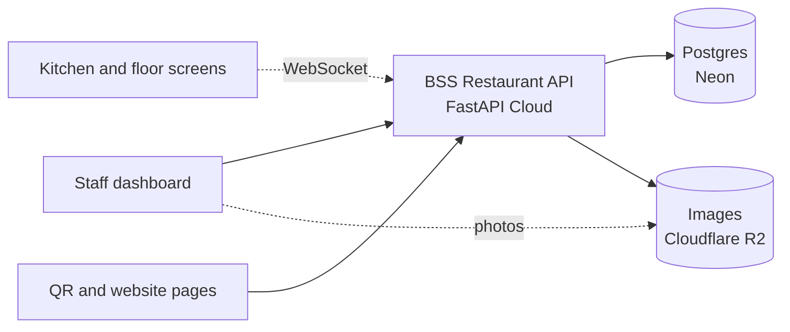
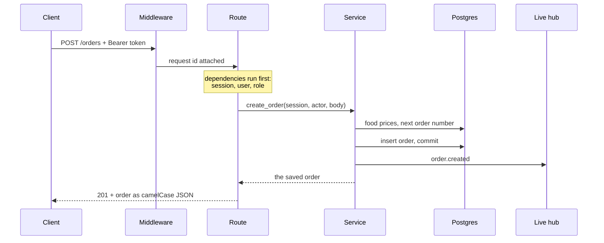

import { Why } from "/snippets/why.jsx";
import { Source } from "/snippets/source.jsx";

## The big picture



- **Clients** only ever talk to the API over HTTPS, plus one WebSocket for live updates. The staff dashboard is one client; a QR ordering page or a restaurant website would be others.
- **The API** holds every rule: prices, who can do what, which order can move where. Clients are never trusted with any of it.
- **Postgres** stores everything. A few rules live in the database itself, as a second line of defence (see [Reservations](/concepts/reservations#no-double-bookings)).
- **R2** stores photos. The API uploads them and hands out their public URLs; browsers download them from R2 directly.

## One request, start to finish

Here's what happens when a waiter sends an order: `POST /api/v1/orders`.



### 1. Middleware

<Source path="app/core/middleware.py" /> gives every request an ID, reusing an `X-Request-ID` sent by the client if it looks sane. It goes into every log line and back out in the response, so a report like "it failed at 9:41" can be matched to the exact log. CORS is checked here too.

### 2. Dependencies

Before the route's own code runs, FastAPI runs its **dependencies**: small functions that each provide one thing. The route asks for them by type:

```python app/api/v1/orders.py
# people who take orders from customers
FrontOfHouse = Annotated[
    User, Depends(require_roles(UserRole.MANAGER, UserRole.WAITER, UserRole.CASHIER))
]

@router.post("", response_model=OrderDetailOut, status_code=status.HTTP_201_CREATED)
async def create_order(body: OrderCreate, session: SessionDep, actor: FrontOfHouse) -> Order:
    return await order_service.create_order(session, actor, body)
```

Three things happen before `create_order` runs:

| Dependency | What it does | Fails with |
| --- | --- | --- |
| `body: OrderCreate` | Pydantic checks the JSON: food IDs are numbers, quantities 1 to 100 | 422 `validation_error` |
| `SessionDep` | Opens a database session for this request, closed when it ends | |
| `FrontOfHouse` | Reads the token, loads the user, checks the role | 401 or 403 |

The role check is a function that builds a dependency, in <Source path="app/api/deps.py" />:

```python app/api/deps.py
def require_roles(*roles: UserRole) -> Callable[[User], Awaitable[User]]:
    """Admins can always pass, everyone else needs one of the given roles."""

    async def checker(user: CurrentUser) -> User:
        if user.role != UserRole.ADMIN and user.role not in roles:
            raise PermissionDeniedError()
        return user

    return checker
```

### 3. The service

<Source path="app/services/orders.py" /> does the work, and this is where the rules are:

1. Load every food in the order. Unknown or sold-out foods stop it here.
2. Price each line **from the menu**, with the food's current discount.
3. Copy the restaurant's VAT and service charge rates onto the order.
4. Get the next order number for today, like `261015-0042`.
5. Save it all in one transaction, so it's either all there or not at all.

After the commit, the service tells the live hub, and every kitchen screen hears about the new order. See [Live updates](/concepts/live-updates).

### 4. The response

The route returns a SQLAlchemy `Order`, and `response_model=OrderDetailOut` turns it into JSON. Only the fields in the schema go out, in camelCase, with money as plain numbers:

```json
{
  "id": 412,
  "orderNumber": "261015-0042",
  "status": "pending",
  "subtotal": 840.0,
  "serviceCharge": 42.0,
  "vat": 66.15,
  "total": 948.15,
  "balanceDue": 948.15,
  "nextStatuses": ["confirmed", "cancelled"]
}
```

(Trimmed: the real response also has the items, the table, the waiter, the history and the payments.)

## When something goes wrong

Services raise errors from <Source path="app/core/exceptions.py" />, like `ConflictError("...", code="order_closed")`. Handlers registered in `main.py` turn every one of them, and anything unexpected, into the same JSON shape:

```json
{ "detail": "The order is already paid", "code": "order_closed" }
```

Clients switch on `code`, which never changes, and can show `detail` to people. [Errors and limits](/concepts/errors-and-limits) lists the codes.

## Two habits worth knowing

**Rows that matter are locked.** Changing an order's status, taking a payment, and editing items all start with `SELECT ... FOR UPDATE`. If two cashiers take a payment on the same bill at the same moment, the second waits for the first to finish, then sees the new balance. Without the lock both could pay the full amount.

**Relationships never load by surprise.** Every relationship in the models is `lazy="raise"`. If code touches `order.items` without asking for the items in the query, it fails loudly in development instead of quietly running an extra query for every row in a list.

<Why>
  Both habits come from the same place: async SQLAlchemy can't load things lazily anyway, and a restaurant at rush hour is exactly when two people do the same thing at once. I'd rather the code says up front what it loads and what it locks.
</Why>

## How the app is put together

<Source path="app/main.py" /> builds the app once, at import:

```python app/main.py
app.middleware("http")(request_id_middleware)
if settings.cors_origins:
    app.add_middleware(CORSMiddleware, allow_origins=settings.cors_origins, ...)

register_exception_handlers(app)
app.include_router(api_router, prefix=settings.api_prefix)

if settings.storage_backend == "local":
    app.mount("/media", StaticFiles(directory=media_dir), name="media")
```

- Every router is collected in <Source path="app/api/v1/router.py" /> and mounted under `/api/v1`.
- `/docs`, `/redoc` and `/openapi.json` exist only when `DOCS_ENABLED` is true.
- `/media` serves uploaded images, but only with local storage. With R2, images never pass through the app.
- On shutdown, the app closes the live hub and the database pool.
