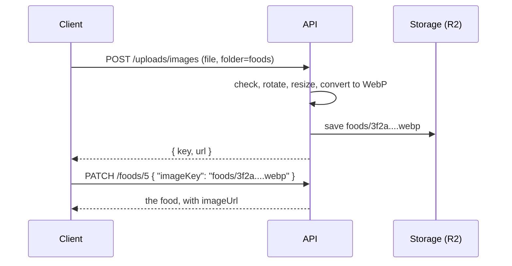

import { Why } from "/snippets/why.jsx";
import { Source } from "/snippets/source.jsx";

Dish photos, category photos, staff photos and expense receipts all work the same way: **upload the file first, then attach the key it gives you.**

## Two steps



**1. Upload.** Send the file as a form, with the folder it's for:

```bash
curl -X POST http://localhost:8000/api/v1/uploads/images \
  -H "Authorization: Bearer $TOKEN" \
  -F "file=@kacchi.jpg" \
  -F "folder=foods"
```

```json
{ "key": "foods/3f2a9c0e8b1d4e6fa7c5d2b1e0f9a8c7.webp", "url": "/media/foods/3f2a9c0e8b1d4e6fa7c5d2b1e0f9a8c7.webp" }
```

**2. Attach.** Send the `key` with the thing it belongs to:

| Folder | Attach it as | On |
| --- | --- | --- |
| `foods` | `imageKey` | `POST /foods`, `PATCH /foods/{id}` |
| `categories` | `imageKey` | `POST /categories`, `PATCH /categories/{id}` |
| `users` | `imageKey` | `POST /employees`, `PATCH /employees/{id}` |
| `receipts` | `receiptKey` | `POST /expenses`, `PATCH /expenses/{id}` |

Responses never show the key. They show `imageUrl` (or `receiptUrl`), ready to put in an ``.

<Why>
  The old app stored images as base64 text inside the database rows, so every menu request dragged every photo along with it. Uploading separately means a form can show the photo the moment it's picked, the JSON stays small, and photos are served from storage instead of the database.
</Why>

## What happens to a file

<Source path="app/services/images.py" /> opens every upload with Pillow and only keeps what it makes itself:

1. **Too big?** Over `MAX_UPLOAD_MB` (5 MB by default) is `413 payload_too_large`.
2. **Really an image?** Only JPEG, PNG, WebP and GIF are accepted, judged by the file's contents, not its name (`400 unsupported_image` or `400 invalid_image`).
3. **Absurd dimensions?** Over 40 million pixels is refused before decoding, so a tiny file that unpacks into a huge image can't eat the server's memory (`400 image_too_large`).
4. **Turned the right way up.** Phones store a photo's rotation separately; it's applied before that information is dropped.
5. **Resized** to fit 1600 × 1600, keeping its shape.
6. **Saved as WebP** at quality 82, with a random name.

So whatever comes in, what's stored is a reasonably sized WebP, without the metadata a camera writes into the original file. The work runs in a worker thread, so a big photo doesn't hold up other requests.

## Keys

A key is the folder plus a random name: `foods/3f2a9c0e8b1d4e6fa7c5d2b1e0f9a8c7.webp`. When you attach one, the API checks it has exactly that shape and the **right folder** (`400 invalid_image_key`). A client can't attach some other file in the bucket, or a receipt photo as a dish photo.

When a photo is replaced, the old file is deleted from storage, and so is the photo of a deleted category or expense. Dishes are only ever soft-deleted, so they keep theirs. If deleting a file fails, it's logged and the request still succeeds: a leftover file isn't worth an error.

## Where files are stored

`STORAGE_BACKEND` picks one of two backends, both in <Source path="app/storage" />:

| | `local` | `r2` |
| --- | --- | --- |
| For | Development and tests | Production |
| Files go to | The `LOCAL_UPLOAD_DIR` folder (`uploads/`) | A [Cloudflare R2](https://developers.cloudflare.com/r2/) bucket |
| URLs look like | `/media/foods/....webp`, served by the API itself | `https://<R2_PUBLIC_URL>/foods/....webp` |

With `local`, the URL starts with `/media`, relative to the API. A client on another address has to put the API's origin in front of it; the dashboard does that in one helper.

With `r2`, files never pass through the API again after the upload. Browsers fetch them straight from R2's public URL, and each file is saved with `Cache-Control: public, max-age=31536000, immutable`. That's safe because a key is never reused: a new photo always gets a new name.

<Warning>
  Don't use `local` in production. FastAPI Cloud's disk is wiped on every deploy, and every uploaded photo with it. See [Deploy](/guides/deploy-to-fastapi-cloud#images-on-r2).
</Warning>

## Adding a storage backend

A backend is any class with three methods, as described in <Source path="app/storage/base.py" />:

```python app/storage/base.py
class Storage(Protocol):
    async def save(self, key: str, data: bytes, content_type: str) -> None: ...

    async def delete(self, key: str) -> None: ...

    def url(self, key: str) -> str: ...
```

R2 speaks the S3 protocol through boto3, so Amazon S3 or another S3-compatible store would only need a different `endpoint_url` in <Source path="app/storage/r2.py" />.
