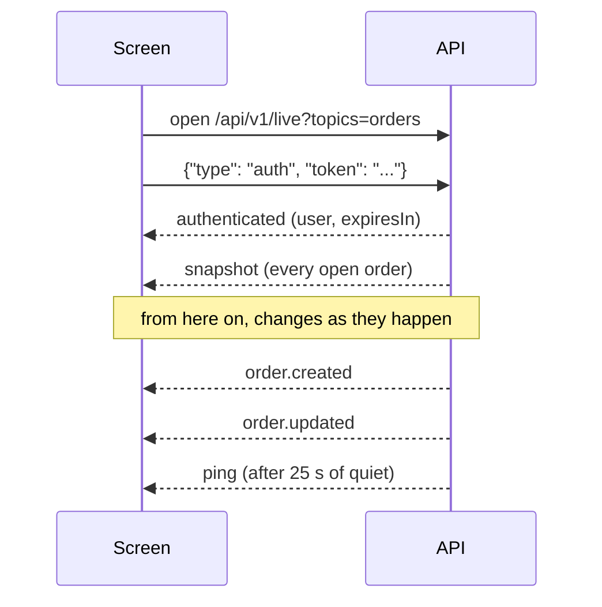
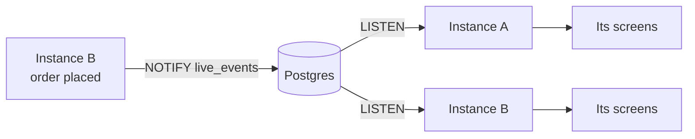

import { Why } from "/snippets/why.jsx";
import { Source } from "/snippets/source.jsx";
import { Shot } from "/snippets/shot.jsx";

A kitchen screen needs to know about a new order the second it's sent. Asking the API every few seconds ("anything new?") is slow and wasteful, so the API keeps a [WebSocket](/reference/glossary#websocket) open to each screen and **pushes** every change down it.

<Shot name="kitchen" darkOnly alt="The dashboard's kitchen board with tickets in Confirmed, Preparing and Ready columns" caption="The dashboard's kitchen board runs entirely on this feed." />

## Connecting

```js
const ws = new WebSocket("wss://<host>/api/v1/live?topics=orders");

ws.onopen = () => ws.send(JSON.stringify({ type: "auth", token: accessToken }));

ws.onmessage = (e) => {
  const msg = JSON.parse(e.data);
  // msg.event: "authenticated", "snapshot", "order.created", "order.updated", ...
};
```

Use `ws://` locally and `wss://` (encrypted) in production.

The token goes in the **first message**, not the URL. Browsers can't add an `Authorization` header to a WebSocket, and a token in the URL ends up in server and proxy logs.



If the auth message doesn't arrive within **10 seconds**, the connection is closed with `4401`.

## Messages from the server

Every message is a JSON object with an `event`:

| `event` | When | Carries |
| --- | --- | --- |
| `authenticated` | After every auth message | `user` (id, name, role) and `expiresIn` in seconds |
| `snapshot` | Right after connecting, and whenever the screen may have missed something | `orders` and/or `reservations`: the full current state |
| `order.created` | An order was placed | `data`: the order |
| `order.updated` | Status change, edit, payment or refund | `data`: the order |
| `reservation.created` | A booking was made, by staff or the website | `data`: the booking |
| `reservation.updated` | Any change to a booking | `data`: the booking |
| `ping` | Every 25 seconds without other messages | Nothing |
| `pong` | Answer to your `{"type": "ping"}` | Nothing |
| `error` | You sent a message type it doesn't know | `detail` |

An event looks like this:

```json
{
  "event": "order.updated",
  "topic": "orders",
  "data": {
    "id": 412,
    "orderNumber": "261015-0042",
    "orderType": "dine_in",
    "source": "staff",
    "status": "preparing",
    "table": { "id": 4, "number": "T4" },
    "waiter": { "id": 3, "fullName": "Rafiq Islam" },
    "items": [{ "foodName": "Kacchi Biryani", "quantity": 2, "notes": null }],
    "itemCount": 5,
    "total": 1453.83,
    "balanceDue": 1453.83,
    "updatedAt": "2026-10-15T14:21:07.512843Z"
  },
  "at": "2026-10-15T14:21:07.530412+00:00"
}
```

(Trimmed.) The live order is deliberately smaller than the full order from `GET /orders/{id}`: what a kitchen ticket or a floor tile needs, and no payment history. For everything, fetch the order.

### What's in the snapshot

| Topic | The snapshot holds |
| --- | --- |
| `orders` | Every open order: not paid and not cancelled |
| `reservations` | Today's confirmed bookings, everyone seated now, and website requests nobody has answered yet |

## Topics

`?topics=orders,reservations` picks what to follow. Both is the default.

| Role | Can follow |
| --- | --- |
| Chef | `orders` only. Asking for `reservations` closes with `4403` |
| Everyone else | Both |

## Staying connected

The connection lives as long as the access token it was opened with. To keep it, send a new auth message with a fresh token **before** `expiresIn` runs out:

```js
ws.send(JSON.stringify({ type: "auth", token: newAccessToken }));
```

You'll get another `authenticated` with the new `expiresIn`. The new token must belong to the same user. If the time runs out first, the server closes the connection with `4401` and the reason `token_expired`.

## Close codes

| Code | Means | What to do |
| --- | --- | --- |
| `4401` | No auth message, a bad token, or the token ran out (reason `token_expired`) | Refresh the token if that's the reason, then reconnect. Otherwise sign out |
| `4403` | Your role can't follow that topic | Don't retry |
| `4400` | A message that isn't a JSON object, or an unknown topic | Don't retry, fix the client |
| Anything else | The network dropped, the server restarted | Reconnect, waiting a little longer each time |

You never have to replay anything after a reconnect: the new connection starts with a fresh snapshot.

## Using it well

- **Treat every event as "upsert by id".** Replace your copy of the order with the new one, or add it if you didn't have it. `order.updated` covers everything from a status change to a payment.
- **Drop orders that are `paid` or `cancelled`.** They'll never change again.
- **When a `snapshot` arrives, replace everything.** Don't merge it.
- **Use `updatedAt`** to ignore an event older than what you already have.

The dashboard does all of this; its docs walk through [the client side](https://bss-restaurant-frontend.mintlify.app/how-it-works/live-updates).

## Inside the server

All open connections in one process share a **hub**, in <Source path="app/core/live.py" />. When a service saves a change, it publishes an event to the hub, which hands it to every connection following that topic.

Each connection has a queue of 200 events. A screen on a bad connection can fall behind; when its queue fills up, the hub empties it and puts a single "resync" in its place, and the screen gets a fresh snapshot instead of a backlog:

```python app/core/live.py
try:
    self._queue.put_nowait(event)
except asyncio.QueueFull:
    while not self._queue.empty():
        self._queue.get_nowait()
    self._queue.put_nowait(RESYNC)
```

Publishing happens **after** the database commit, and a failure to publish is logged, not raised. A hiccup in the live feed never fails the request that made the change.

A connection subscribes to the hub **before** it reads the snapshot, so a change made in between is sent as an event rather than lost.

## More than one instance

The hub lives in one process's memory. If FastAPI Cloud runs two copies of the app, a screen connected to copy A never hears about an order placed through copy B.

Set `LIVE_BACKEND=postgres` and every event goes through Postgres instead, using `LISTEN` and `NOTIFY`:



Each instance publishes with `NOTIFY` and listens on the `live_events` channel, so every instance, including the one that published, delivers the event to its own screens.

Things to know before turning it on with Neon:

- **Listening needs a direct connection.** Neon's pooled connection can't `LISTEN`, so the relay opens its own direct one, and only while that instance has screens connected.
- **It keeps the database awake.** After a few quiet minutes Neon suspends the database and drops the listening connection. The relay reconnects, which wakes it, and screens get a fresh snapshot, so nothing is lost. But with screens connected the database hardly sleeps. Neon recommends turning scale-to-zero off for `LISTEN`.
- **A `NOTIFY` can't carry 8000 bytes or more.** An order too big for that arrives with just its `id` and `"partial": true`. Fetch it with `GET /orders/{id}`.

<Why>
  I didn't want Redis just for this. Postgres was already there, `LISTEN`/`NOTIFY` is built in, and with one instance the memory hub needs nothing at all. The relay is only switched on when it's needed.
</Why>
