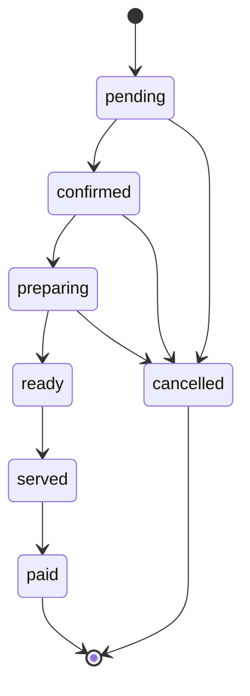

import { Why } from "/snippets/why.jsx";
import { Source } from "/snippets/source.jsx";

An order is one table's (or one takeaway customer's) food, from the moment it's taken until the bill is paid. Everything about it is in <Source path="app/services/orders.py" /> and <Source path="app/models/order.py" />.

## Placing an order

The client sends **what** was ordered, never what it costs:

```json POST /api/v1/orders
{
  "orderType": "dine_in",
  "tableId": 4,
  "items": [
    { "foodId": 5, "quantity": 2 },
    { "foodId": 6, "quantity": 1, "notes": "less spicy" },
    { "foodId": 19, "quantity": 2 }
  ]
}
```

| Field | Rules |
| --- | --- |
| `orderType` | `dine_in` (the default) or `takeaway` |
| `tableId` | Required for dine-in, not allowed for takeaway. The table must be active |
| `items` | 1 to 50 lines, each with a quantity from 1 to 100 and an optional note |
| `waiterId` | Optional. Leave it out and the person placing the order becomes the waiter, if they have an employee record |
| `customerName`, `customerPhone`, `notes` | Optional |

If a food doesn't exist or is sold out, nothing is saved: the API answers `400 unknown_foods` or `400 foods_unavailable`, with the offending `foodIds`.

## How the money is worked out

Each line is priced from the menu **at that moment**, and the price is copied onto the line:

| Line field | Meaning |
| --- | --- |
| `unitPrice` | The menu price |
| `unitDiscount` | How much the food's discount takes off one |
| `finalUnitPrice` | What one actually costs |
| `lineTotal` | `finalUnitPrice × quantity` |

Then the order's totals:

```python app/services/orders.py
def _recalculate(order: Order) -> None:
    order.subtotal = sum((i.unit_price * i.quantity for i in order.items), Decimal(0))
    order.discount_total = sum((i.unit_discount * i.quantity for i in order.items), Decimal(0))
    food_total = sum((i.line_total for i in order.items), Decimal(0))
    order.service_charge = _percent_of(food_total, order.service_charge_rate)
    # vat is charged on the service charge as well
    order.vat = _percent_of(food_total + order.service_charge, order.vat_rate)
    order.total = food_total + order.service_charge + order.vat
```

With the demo menu (5% service charge, 7.5% VAT), the order above comes to:

| | |
| --- | ---: |
| 2 × Kacchi Biryani at ৳420 | ৳840.00 |
| 1 × Chicken Biryani at ৳320, 10% off | ৳288.00 |
| 2 × Borhani at ৳80 | ৳160.00 |
| **`subtotal`** (before discounts) | ৳1,320.00 |
| **`discountTotal`** | ৳32.00 |
| Food total | ৳1,288.00 |
| **`serviceCharge`**, 5% of the food | ৳64.40 |
| **`vat`**, 7.5% of food + service charge | ৳101.43 |
| **`total`** | **৳1,453.83** |

A few rules hide in there:

- **Service charge is for table service.** Takeaway orders have a rate of 0.
- **The rates are copied onto the order** when it's placed (`serviceChargeRate`, `vatRate`). Changing them in the settings doesn't touch orders already open.
- **Rounding is to the paisa, half up**, using Python's `Decimal`, never floats.
- **The same food with the same note becomes one line.** Sending Borhani twice gives one line with quantity 2.

<Why>
  In the app this one replaced, the browser sent the prices. Anyone with the browser's dev tools could order a biryani for one taka. Here the client can't even say what anything costs, and copying the price onto the line means changing the menu tomorrow can't rewrite yesterday's bills.
</Why>

## Order numbers

Orders get a number like `261015-0042`: the restaurant's date, then a counter that starts again at 1 every day. Staff can read it out loud, and it fits on a kitchen ticket.

Two waiters sending orders at the same instant must never get the same number. One `INSERT ... ON CONFLICT DO UPDATE` handles it, in <Source path="app/services/order_numbers.py" />:

```python app/services/order_numbers.py
stmt = (
    insert(OrderCounter)
    .values(business_date=day, last_number=1)
    .on_conflict_do_update(
        index_elements=[OrderCounter.business_date],
        set_={"last_number": OrderCounter.last_number + 1},
    )
    .returning(OrderCounter.last_number)
)
```

Postgres locks the day's counter row until the transaction ends, so the second order waits a moment and gets 43. If saving the order fails, the counter rolls back with it, and no number is skipped.

"The restaurant's date" follows `RESTAURANT_TZ`: an order at 00:30 in Dhaka belongs to that morning, even though it's still the previous day in UTC.

Order numbers are easy to guess, so customers never use them to look an order up. Every order also gets a random `trackingCode` for that. See [Public ordering](/concepts/public-ordering).

## The lifecycle



| Status | Means | Moved here by |
| --- | --- | --- |
| `pending` | Taken, not yet sent to the kitchen. Guest orders from a QR code or the website wait here for staff | Placing the order |
| `confirmed` | Sent to the kitchen | Manager, waiter, cashier |
| `preparing` | The kitchen started | Manager, chef |
| `ready` | Waiting at the pass | Manager, chef |
| `served` | On the table, or handed to the takeaway customer | Manager, waiter |
| `paid` | The bill is settled. Closed | Nobody: it happens by itself |
| `cancelled` | Called off, with a reason. Closed | Manager, waiter, cashier. Only managers once it's `preparing` |

Move an order with:

```json POST /api/v1/orders/412/status
{ "status": "cancelled", "note": "customer left" }
```

Only the arrows in the diagram are allowed. Anything else is `409 invalid_status_change`, with the moves that are allowed in `allowed`. Each order in a response carries them as `nextStatuses`, so a client knows which buttons to show without copying these rules (see [Roles](/concepts/roles#order-status-moves) for the role side).

### Rules on the way

- **Cancelling needs a reason** (`400 reason_required`), saved as `cancelReason`.
- **An order holding money can't be cancelled.** Refund it first (`409 refund_required`). See [Payments and refunds](/concepts/payments-and-refunds#refunds).
- **`paid` can't be set by hand** (`409 payment_required`). It's set when a payment settles a served order.
- **Paid up front?** A takeaway paid at the counter becomes `paid` the moment it's marked `served`.
- **Guest orders get a waiter when confirmed.** Whoever confirms a QR or online order becomes its waiter.
- **Closed is closed.** `paid` and `cancelled` orders can't be edited (`409 order_closed`).

Every move is saved in the order's `history`, with who made it, when, and the note.

## Changing what was ordered

| Endpoint | Does | Allowed while |
| --- | --- | --- |
| `PUT /orders/{id}/items` | Replaces every line | `pending`, `confirmed`: the kitchen hasn't started |
| `POST /orders/{id}/items` | Adds new lines, like a dessert later on | `pending`, `confirmed`, `preparing` |
| `PATCH /orders/{id}` | Changes the table, waiter, customer details or notes | Any open order |

Added items become **new lines**, so the lines already cooking keep their price. If replacing the items brings the total below what's already been paid, it's refused with `refund_required`.

## Finding orders

`GET /orders` takes the usual `page`, `size`, `search` and `sort` (see [Errors and limits](/concepts/errors-and-limits#lists)), plus:

| Filter | Example |
| --- | --- |
| `status` (repeatable) | `?status=ready&status=served` |
| `active` | `?active=true`: everything not paid or cancelled |
| `source` (repeatable) | `?source=qr&source=online&status=pending` is the "incoming" list |
| `orderType`, `tableId`, `waiterId` | `?tableId=4&active=true` |
| `dateFrom`, `dateTo` | Restaurant dates, both included |

`search` looks in the order number, customer name and phone. `sort` accepts `createdAt`, `orderNumber`, `total` and `status`, newest first by default.

## Tables and orders

There's no "occupied" flag to keep in sync. A table's `isOccupied` is worked out in the query: it's true while the table has an order that isn't paid or cancelled.
