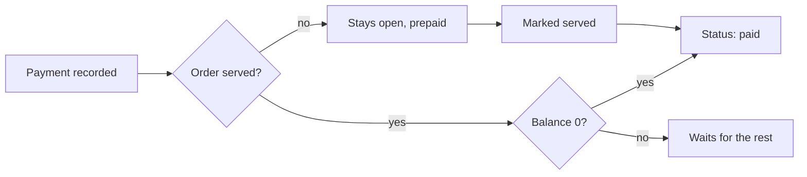

import { Why } from "/snippets/why.jsx";
import { Source } from "/snippets/source.jsx";
import { Figure } from "/snippets/figure.jsx";

Money moves in two directions: **payments** in, **refunds** out. Both are rows in the `payments` table, told apart by `kind`, and both live in <Source path="app/services/payments.py" />.

Every order keeps two running numbers:

| Field | Means |
| --- | --- |
| `amountPaid` | Payments minus refunds so far |
| `balanceDue` | `total − amountPaid`, never below 0. Always 0 once the order is closed |

## Taking a payment

Cashiers and managers call:

```json POST /api/v1/orders/412/payments
{ "method": "cash", "tendered": 1500 }
```

| Field | Rules |
| --- | --- |
| `method` | `cash`, `card` or `mobile` (bKash, Nagad, Rocket and the like) |
| `amount` | Optional. Leave it out to pay whatever is left |
| `tendered` | Cash only: what the customer handed over. The change is worked out from it |
| `reference` | The card slip number, or the transaction ID. **Required for mobile** |
| `note` | Optional |

The answer is the whole order, with the new payment in `payments`. For the cash example above, on the ৳1,453.83 order from [Orders](/concepts/orders#how-the-money-is-worked-out):

```json
{
  "kind": "payment",
  "method": "cash",
  "amount": 1453.83,
  "tendered": 1500.0,
  "change": 46.17
}
```

### What gets refused

| Code | When |
| --- | --- |
| `409 overpayment` | `amount` is more than the balance. The answer includes `balanceDue` |
| `409 nothing_to_pay` | The balance is already 0 |
| `409 order_closed` | The order is paid or cancelled |
| `400 not_enough_cash` | `tendered` is less than `amount` |
| `422 validation_error` | `tendered` on a card payment, or a mobile payment without `reference` |

## Split bills

A split bill is just several payments, each to `POST /orders/412/payments`. Three friends paying ৳400 each, then a fourth paying the rest by bKash:

| | Body | Balance after |
| --- | --- | ---: |
| 1 | `{"method": "cash", "amount": 400}` | ৳1,053.83 |
| 2 | `{"method": "card", "amount": 400, "reference": "SLIP-2291"}` | ৳653.83 |
| 3 | `{"method": "cash", "amount": 400}` | ৳253.83 |
| 4 | `{"method": "mobile", "reference": "BK8H2K4M9P"}` | ৳0.00 |

The last one leaves out `amount`, so it pays exactly what's left (৳253.83). Each payment records who took it.

The order row is locked while a payment is recorded. If two cashiers pay the same bill at the same moment, the second waits, sees the new balance, and is refused if there's nothing left. Nobody pays twice.

## When an order becomes paid



- A **served** order becomes `paid` the moment its balance hits 0.
- An order paid **before** it's served, like a takeaway paid at the counter, stays open while it's cooked and becomes `paid` when it's handed over (`served`).

Either way the order history says why: "bill settled" or "paid before serving".

<Why>
  Nobody can mark an order paid by hand, because that's exactly how money goes missing: an order marked paid with no payment behind it. Here `paid` is a fact the API works out from the payments, so the till and the reports can't disagree.
</Why>

## Refunds

Managers give money back with:

```json POST /api/v1/orders/412/refunds
{ "method": "cash", "amount": 120, "reason": "Firni was missing" }
```

| Field | Rules |
| --- | --- |
| `method` | How the money goes back |
| `amount` | At most `amountPaid` (`409 refund_too_high`, with `refundable`) |
| `reason` | Required, 3 to 255 characters |
| `reference` | Optional |

A refund lowers `amountPaid`. A **paid order stays paid**: the refund is a correction after the sale, and the reports count it on the day it was given. See [Reports](/concepts/reports#what-counts).

Refunds also unlock two things:

- **Cancelling an order that holds money.** The API refuses to cancel it (`409 refund_required`, with `amountPaid`), so the money can't vanish with the order. Refund it all, then cancel.
- **Making an order smaller.** Replacing the items can't bring the total below what's been paid. Refund the difference first.

## Receipts

```bash
GET /api/v1/orders/412/receipt
GET /api/v1/orders/412/receipt?print=true
```

This returns an HTML page made from <Source path="app/templates/receipt.html" />, sized for 80 mm thermal printers. It's a **bill** while the order is open and a **receipt** once it's paid. Cancelled orders don't have one (`409 order_cancelled`).

<Figure src="/images/receipt.webp" narrow alt="An 80 mm receipt from Shorshe Kitchen with items, service charge, VAT, total and a cash payment with change" caption="A paid receipt for a demo order, as the browser renders it." />

It shows the restaurant's name, address and VAT number (`taxId`) from the settings, every line with its discount, the service charge and VAT with their rates, the payments with change, and the `receiptFooter`. Times are in the restaurant's time zone.

- `?print=true` opens the print dialog as soon as the page loads.
- It needs a signed-in user like any other endpoint, so a browser can't just open the URL. The dashboard fetches it with the token and shows it in a sandboxed frame.
- Food and customer names are escaped by Jinja2, so a dish called `<script>` prints as text.
