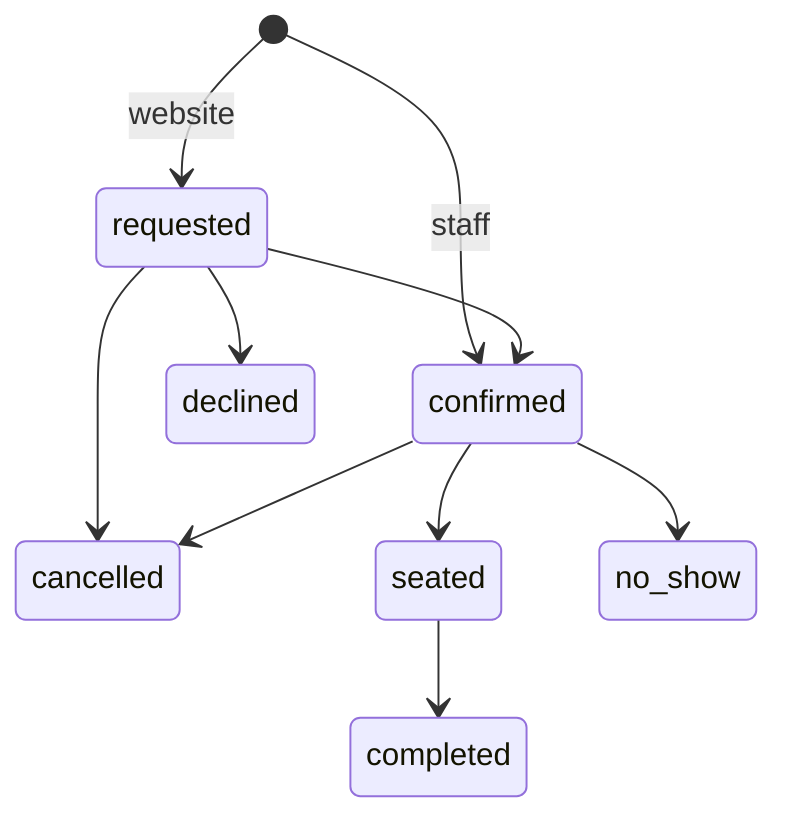

import { Why } from "/snippets/why.jsx";
import { Source } from "/snippets/source.jsx";

A reservation holds **one table** for a stretch of time: from `startsAt` for the restaurant's `reservationMinutes` (90 by default), or for its own `minutes`. The code is in <Source path="app/services/reservations.py" />.

## Booking a table

Staff take bookings on the phone or at the door:

```json POST /api/v1/reservations
{
  "startsAt": "2026-10-16T20:00:00+06:00",
  "partySize": 4,
  "customerName": "Nadia",
  "customerPhone": "01711000000",
  "notes": "birthday"
}
```

| Field | Rules |
| --- | --- |
| `startsAt` | With its time zone offset. At most 15 minutes in the past, for someone booking a walk-in |
| `partySize` | 1 to 50 |
| `minutes` | Optional, 15 to 480. Defaults to the restaurant's booking length |
| `tableId` | Optional. Leave it out and the API picks one |
| `customerName`, `customerPhone` | Required |
| `customerEmail`, `notes` | Optional |

Staff bookings are `confirmed` straight away, because the person taking them can see the tables. Bookings from the website start as `requested`; see [Public ordering](/concepts/public-ordering#table-bookings).

## How a table is picked

Without a `tableId`, the API takes the **smallest free table that fits**:

```python app/services/reservations.py
tables = await session.scalars(
    select(DiningTable)
    .where(
        DiningTable.is_active.is_(True),
        DiningTable.seats >= party_size,
        DiningTable.id.not_in(_booked(starts_at, ends_at, exclude_id)),
    )
    .order_by(DiningTable.seats, DiningTable.number)
)
```

So a couple gets a table for two, and the table for eight stays free for a family. If nothing fits, the answer is `409 no_table_available`.

With a `tableId`, the API checks that table instead: it must be active (`400 invalid_table`), big enough (`409 table_too_small`) and free (`409 table_not_available`).

To see the options before booking:

```bash
GET /api/v1/reservations/availability?startsAt=2026-10-16T20:00:00%2B06:00&partySize=4
```

It returns the free tables that fit, smallest first. It doesn't look at opening hours, so staff can book a late party if they want to.

## No double bookings

The check above has a gap. Two people book the last table at the same moment: both requests check, both see it free, both save. The fix lives in the database itself, as an **exclusion constraint** in <Source path="app/models/reservation.py" />:

```python app/models/reservation.py
ExcludeConstraint(
    (Reservation.table_id, "="),
    (func.tstzrange(Reservation.starts_at, Reservation.ends_at), "&&"),
    name="ex_reservations_no_double_booking",
    using="gist",
    where="status IN ('confirmed', 'seated')",
)
```

Read it as: *no two rows may have the same table **and** overlapping time ranges, among bookings that hold a table.* Postgres enforces it on every insert and update, so the second booking fails no matter how close the timing. The API turns that failure into `409 table_not_available` with "Someone just booked that table, please pick another".

A few details:

- **Only `confirmed` and `seated` bookings hold a table.** Requests, cancellations and no-shows don't block anything.
- **Back to back is fine.** A range includes its start and not its end, so a booking ending at 20:30 and one starting at 20:30 don't overlap.
- The `=` on `table_id` inside a GiST index needs the `btree_gist` extension. The reservations migration turns it on; Neon and the Postgres image in `compose.yaml` both have it.

<Why>
  Checking in Python first still matters, because it gives a clear answer like "Table 4 only seats 2". But only the database sees every request at once, so it gets the last word. A rule that has to hold even when two requests race belongs in the database.
</Why>

## The lifecycle



Move a booking with `POST /reservations/{id}/status`:

| Move to | Rules |
| --- | --- |
| `confirmed` | Gets a table: the one in `tableId`, the one it already has, or the smallest free one. Refused if the booking is already over |
| `seated` | The guests arrived |
| `completed` | The guests left |
| `no_show` | Only once the booking time has passed (`409 too_early`) |
| `cancelled`, `declined` | Need a `note`, which is saved as `cancelReason`. **The customer sees it** when they look the booking up |

Managers, waiters and cashiers can make every move. Anything else is `409 invalid_status_change`, with the allowed moves in `allowed`. Each booking also has `nextStatuses`.

## Changing a booking

`PATCH /reservations/{id}` changes the time, length, party size, table or contact details, while the booking is `requested` or `confirmed`. Anything later is `409 reservation_closed`.

A confirmed booking keeps its table unless you ask for another, and that table is checked again for the new time and size. So moving a booking from 20:00 to 21:00 fails if someone else has the table at 21:00, rather than quietly double booking it.

## Finding bookings

`GET /reservations` takes `page`, `size`, `search` and `sort`, plus:

| Filter | Example |
| --- | --- |
| `dateFrom`, `dateTo` | `?dateFrom=2026-10-16` is that day's list, sorted by time |
| `status` (repeatable) | `?status=requested`: website bookings waiting for an answer |
| `source` | `staff` or `online` |
| `tableId` | One table's bookings |

Dates are restaurant dates, so "the 16th" means midnight to midnight in Dhaka.

## Live

Every new booking and every change is sent to the live feed as `reservation.created` or `reservation.updated`, so the front desk sees website bookings arrive without refreshing. See [Live updates](/concepts/live-updates).
