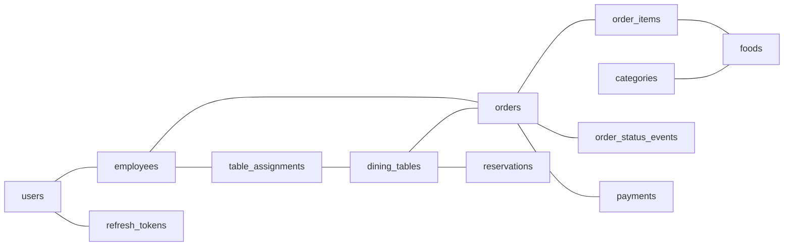

import { Why } from "/snippets/why.jsx";
import { Source } from "/snippets/source.jsx";

## The tables



| Table | Holds |
| --- | --- |
| `restaurant` | The one row of settings: name, VAT, service charge, opening hours, ordering switches |
| `users` | Sign-ins: email, password hash, role |
| `refresh_tokens` | One row per refresh token, by hash. See [Auth and tokens](/concepts/auth-and-tokens) |
| `employees` | Staff records, optionally linked to a user |
| `dining_tables` | Tables with their number, seats, location and QR token |
| `table_assignments` | Which employees serve which table |
| `categories`, `foods` | The menu. Foods are only ever soft-deleted |
| `orders` | One per order, with its totals copied at the time |
| `order_items` | The lines, each with the price it was sold at |
| `order_status_events` | Every status change: who, when, why |
| `order_counters` | The last order number handed out each day |
| `payments` | Payments and refunds, told apart by `kind` |
| `reservations` | Bookings |
| `expenses` | What the restaurant spent |

The models are in <Source path="app/models" />, one file per area.

### Conventions in the models

- **Money is `Numeric(12, 2)`** in the database and `Decimal` in Python. Never floats, which can't store 0.1 exactly.
- **Every timestamp has a time zone** (`timestamptz`), and the API stores UTC. Conversion to Dhaka time happens only for "which day is it" and for display.
- **Enums are text with a check constraint**, not Postgres enum types. Adding a status later is a one-line migration instead of an `ALTER TYPE` dance.
- **Constraint names are predictable**, from a naming convention in <Source path="app/models/base.py" />, so a later migration can drop them by name.
- **The database checks what it can**: totals never negative, a dine-in order always has a table, a percentage discount at most 100, one restaurant row only, no double-booked tables.

## Neon

[Neon](https://neon.tech) is Postgres that sleeps. A database nobody has used for a few minutes suspends, and the next query wakes it up, which takes a moment. That's why it's free for a small project, and it needs a few settings to work smoothly.

### Pooled and direct connections

Neon gives you two connection strings for each database:

| | Pooled | Direct |
| --- | --- | --- |
| Host | `ep-...-pooler.region.aws.neon.tech` | `ep-....region.aws.neon.tech` |
| Goes through | PgBouncer, which shares a few real connections between many clients | Straight to Postgres |
| Use it for | The app | Migrations, and `LISTEN` for the [live relay](/concepts/live-updates#more-than-one-instance) |

Set `DATABASE_URL` to the **pooled** string, as Neon gives it to you. The API turns it into what it needs: it switches the driver to asyncpg, translates `sslmode`, and drops `channel_binding`, which asyncpg doesn't understand. Migrations work out the direct host by removing `-pooler` from it. You only need `DATABASE_URL_DIRECT` for a provider where that trick doesn't work.

### Settings that make the pooler happy

<Source path="app/core/database.py" /> creates the engine:

```python app/core/database.py
engine = create_async_engine(
    settings.async_database_url,
    echo=settings.db_echo,
    pool_size=5,
    max_overflow=5,
    pool_pre_ping=True,
    # neon suspends idle computes, so don't keep connections around for too long
    pool_recycle=300,
    connect_args={
        # the neon pooler runs pgbouncer in transaction mode, asyncpg's statement
        # cache and sequential statement names don't play well with that
        "statement_cache_size": 0,
        "prepared_statement_name_func": lambda: f"__asyncpg_{uuid4()}__",
    },
)
```

- **`pool_pre_ping`** checks a connection is alive before using it, because Neon may have dropped it while sleeping.
- **`pool_recycle=300`** replaces connections older than five minutes.
- **The two `connect_args`** stop asyncpg reusing prepared statements. In transaction mode, PgBouncer can hand each transaction a different real connection, and a statement prepared on one doesn't exist on another. Without these, you get random "prepared statement does not exist" errors under load.

### Waking up

The first query after a sleep is slow. `GET /health` gives the database 5 seconds before reporting it unreachable, and the dashboard calls `/health` when the sign-in page opens, so the database is usually awake by the time someone has typed their password.

### Keep it next to the app

Put the Neon project in the **same region as the app**. Every request makes a few round trips to the database, and distance multiplies. Measured from the app, FastAPI Cloud runs in AWS US East, so production lives in `aws-us-east-1`: a page that took 1.5 to 2.5 seconds with the database in Singapore takes 20 to 30 milliseconds there.

For local work, a Neon branch near you, or Docker, is the better choice.

## Migrations

A migration is a small script that changes the database's structure: add a table, add a column, change an index. They live in `alembic/versions/`, and [Alembic](https://alembic.sqlalchemy.org) applies them in order and remembers which ones ran.

### Making one

<Steps>
  <Step title="Change the model">
    Add the column or table in `app/models/`. A new model file also needs importing in <Source path="app/models/__init__.py" />, or Alembic can't see it.
  </Step>
  <Step title="Generate the migration">
    ```bash
    uv run alembic revision --autogenerate -m "add allergens to foods"
    ```

    Alembic compares the models with the database and writes the difference as a script.
  </Step>
  <Step title="Read it">
    Autogenerate is a good first draft, not a finished one. Check the new file: it can miss renames (it sees a drop and an add), server defaults, and extensions.
  </Step>
  <Step title="Apply it">
    ```bash
    uv run alembic upgrade head
    ```
  </Step>
</Steps>

Useful commands:

| Command | Does |
| --- | --- |
| `uv run alembic current` | Which migration the database is at |
| `uv run alembic history` | Every migration, in order |
| `uv run alembic downgrade -1` | Undo the last one |
| `uv run alembic check` | Fails if the models have changes no migration covers. CI runs this |

Before migrating, <Source path="alembic/env.py" /> logs which host and database it's about to touch. It's easy to point at the wrong one.

### Migrations and deploys

The rule that keeps deploys safe: **the running app must work with the database both before and after the migration.**

| Change | Order |
| --- | --- |
| Adding: a table, a nullable column, an index | Migrate **first**, then deploy |
| Removing or renaming | Deploy code that stops using it **first**, then migrate |

FastAPI Cloud rolls out a new version gradually, so for a moment the old and new versions run side by side. Every migration so far only adds things, which is why the [deploy guide](/guides/deploy-to-fastapi-cloud) migrates before deploying.

<Why>
  Migrations run from my machine, not when the app starts. Several instances starting at once would each try to migrate, and a migration that fails is much easier to deal with in a terminal than halfway through a deploy.
</Why>
