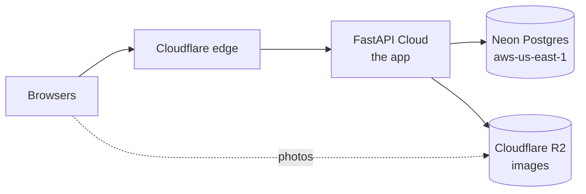

import { Why } from "/snippets/why.jsx";
import { Source } from "/snippets/source.jsx";

Production is three services, each doing one thing:



You'll need accounts on [FastAPI Cloud](https://fastapicloud.com), [Neon](https://neon.tech) and [Cloudflare](https://dash.cloudflare.com). The steps below go in this order on purpose: the database and storage exist before the app first starts.

## The database

1. In Neon, create a project in **AWS US East 1** (`aws-us-east-1`), next to FastAPI Cloud. [Distance matters a lot](/guides/database#keep-it-next-to-the-app).
2. Copy the **pooled** connection string. It has `-pooler` in the host.
3. From your machine, create the tables and the first admin:

```bash
DATABASE_URL="<neon pooled url>" uv run alembic upgrade head
DATABASE_URL="<neon pooled url>" uv run python -m app.cli create-admin
```

Migrations find the direct (non-pooled) host by themselves. Doing this before the app is connected means it never sees an empty database.

## Images on R2

FastAPI Cloud's disk doesn't survive a deploy, so photos must go somewhere else.

1. In Cloudflare, go to **R2** and create a bucket, for example `bss-restaurant`.
2. In the bucket's settings, turn on **public access**, either the `r2.dev` address or your own domain. Copy that public URL.
3. Create an **R2 API token** with read and write access to that bucket. Note the access key ID, the secret, and your account ID.

## The app

Log in once, then deploy from the repo:

```bash
uv run fastapi login
uv run fastapi deploy
```

The first deploy creates the app and shows its address, like `https://bss-restaurant.fastapicloud.dev`. FastAPI Cloud finds the app through `[tool.fastapi]` in <Source path="pyproject.toml" />, and skips what <Source path=".fastapicloudignore" /> lists: tests, CI, the compose file and these docs.

Until it has its settings and a database, `/health` reports the database as unreachable. That's next.

## Settings

Set each variable with `fastapi cloud env set`. Use `--secret` for anything private: secrets can't be read back, even by you.

```bash
uv run fastapi cloud env set ENVIRONMENT production
uv run fastapi cloud env set --secret SECRET_KEY "<random, 32+ characters>"
uv run fastapi cloud env set CORS_ORIGINS "https://your-dashboard.vercel.app"
uv run fastapi cloud env set CLIENT_IP_HEADER cf-connecting-ip

uv run fastapi cloud env set STORAGE_BACKEND r2
uv run fastapi cloud env set R2_ACCOUNT_ID "<account id>"
uv run fastapi cloud env set --secret R2_ACCESS_KEY_ID "<access key id>"
uv run fastapi cloud env set --secret R2_SECRET_ACCESS_KEY "<secret>"
uv run fastapi cloud env set R2_BUCKET bss-restaurant
uv run fastapi cloud env set R2_PUBLIC_URL "https://pub-xxxx.r2.dev"
```

Make a `SECRET_KEY` with:

```bash
python -c "import secrets; print(secrets.token_urlsafe(48))"
```

The app refuses to start outside `local` without a real one, and with R2 selected but any `R2_*` setting missing. A typo here fails loudly at startup, not later on a customer's order.

<Warning>
  **Don't skip `CLIENT_IP_HEADER`.** On FastAPI Cloud the client address otherwise comes from the first `X-Forwarded-For` entry, which anyone can make up. The sign-in limits would count every made-up address separately, and stop protecting anything. Cloudflare, in front of FastAPI Cloud, sets `CF-Connecting-IP` itself and refuses requests that try to send their own.
</Warning>

### Optional

| Variable | When |
| --- | --- |
| `DOCS_ENABLED=false` | To hide `/docs` and `/openapi.json` in production |
| `LIVE_BACKEND=postgres` | When FastAPI Cloud runs more than one instance. [Read this first](/concepts/live-updates#more-than-one-instance) |

Every setting is described in [Configuration](/reference/configuration).

## Connect the database

In FastAPI Cloud, open the app, go to **Storage**, and connect the Neon project, branch and database. FastAPI Cloud then manages `DATABASE_URL` for you, and won't let you set it by hand.

<Note>
  The integration copies the database password when it connects. If you ever reset the password in Neon, disconnect and connect the database again, or the app can't sign in. Without the integration, set it yourself with `fastapi cloud env set --secret DATABASE_URL "<pooled url>"`.
</Note>

## Deploy and check

```bash
uv run fastapi deploy
curl https://<your app>.fastapicloud.dev/api/v1/health
```

```json
{ "status": "ok", "database": "ok", "version": "1.0.0", "environment": "production" }
```

Then sign in through `/docs` with the admin you created, or point the [dashboard](https://bss-restaurant-frontend.mintlify.app/guides/deploy-to-vercel) at the new address.

Want demo data in production? See [Demo data](/guides/demo-data#rules): it needs `--allow-production`, and a few precautions before you make the demo accounts public.

## Later deploys

For a change with no migration, just:

```bash
uv run fastapi deploy
```

With a migration, the order depends on what it does:

| The migration... | Order |
| --- | --- |
| Adds a table, a nullable column or an index | Migrate, then deploy |
| Removes or renames something | Deploy code that no longer uses it, then migrate |

FastAPI Cloud rolls a new version out gradually, so for a short while the old and new versions both run against the same database. Each must work with the schema as it is. More in [Database](/guides/database#migrations-and-deploys).

## Housekeeping

Used refresh tokens pile up in the database. Clear the expired ones, and revoked ones older than 30 days, now and then:

```bash
DATABASE_URL="<neon pooled url>" uv run python -m app.cli prune-tokens
```

<Why>
  FastAPI Cloud's docs don't say where it runs; measured from the app, it's AWS US East. So the database follows the app there instead of staying close to Dhaka. Being near the app matters more than being near the people: one page load is a single trip from Dhaka to the app, but several trips from the app to the database.
</Why>
